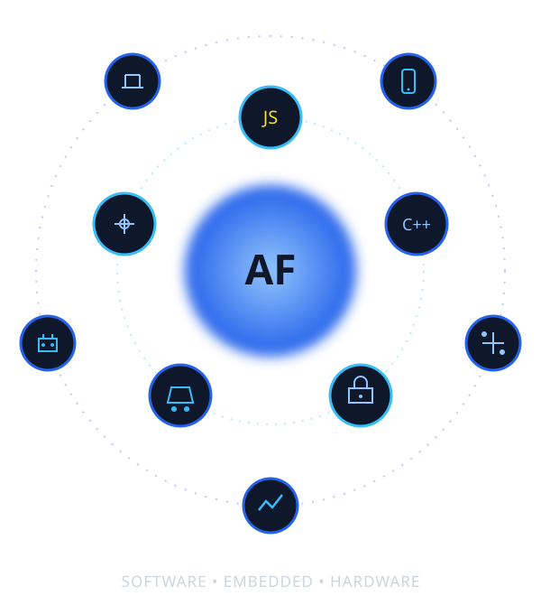
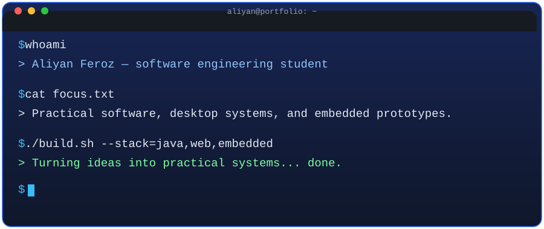

<!-- Aliyan Feroz | Software Engineering | Java, C++, Web & Embedded Systems -->

<div align="center">


<br/>

<a href="https://github.com/Aliyan-Feroz"></a>
<a href="https://linkedin.com/in/aliyan-feroz"></a>


<br/>


</div>

<br/>


## Profile

I'm **Aliyan Feroz**, a Software Engineering student at **The University of Lahore, Sgd Campus**. I build practical software that reduces repetitive work, desktop systems that make operations clearer, and embedded prototypes that connect code to physical behaviour.

<table>
<tr><th align="left">Focus</th><th align="left">What that means in practice</th></tr>
<tr><td><b>Software systems</b></td><td>Object-oriented Java applications, C++ utilities, and structured problem-solving</td></tr>
<tr><td><b>Web applications</b></td><td>Responsive JavaScript interfaces with practical API integrations and deployment</td></tr>
<tr><td><b>Embedded systems</b></td><td>Arduino-based prototypes, sensors, wireless communication, and hardware diagnostics</td></tr>
<tr><td><b>Approach</b></td><td>Start with the workflow, keep the solution understandable, then make it reliable</td></tr>
</table>

<br/>


## Core Competencies

<div align="center">

</div>

<table>
<tr><th align="left">Domain</th><th align="left">Current direction</th></tr>
<tr><td><b>Java desktop development</b></td><td>Object-oriented applications with JavaFX, Maven, SQLite, and IntelliJ IDEA</td></tr>
<tr><td><b>Core programming</b></td><td>C++, C, Java, and JavaScript—used for software foundations and problem solving</td></tr>
<tr><td><b>Web &amp; integrations</b></td><td>HTML, CSS, JavaScript, Google Sheets API, and Vercel deployment</td></tr>
<tr><td><b>Embedded systems</b></td><td>Arduino, sensor data, RF communication, and safety-focused hardware prototypes</td></tr>
</table>

<br/>


## System Overview

<div align="center">

</div>

<br/>


## Technical Stack


<details>
<summary><b>Open the technical breakdown</b></summary>

<br/>

| Area                        | Tools &amp; technologies                                                                | What I use them for                                                |
| :-------------------------- | :-------------------------------------------------------------------------------------- | :----------------------------------------------------------------- |
| **Languages**               | C++ · C · Java · JavaScript · HTML5 · CSS3                                              | Algorithms, object-oriented programming, utilities, and interfaces |
| **Software &amp; Web Dev**  | JavaFX · Maven · REST-style integrations · Google Sheets API                            | Desktop workflows, web utilities, and API-backed data              |
| **Database &amp; Cloud**    | SQLite · Google Sheets · Netlify · Vercel                                               | Lightweight local storage, simple managed data, and deployment     |
| **Embedded &amp; Hardware** | Arduino · ESP32 · Arduino Nano · MPU-6050 · 433MHz RF · IR sensors · Ultrasonic sensors | Sensor-driven prototypes, communication, and hardware interaction  |
| **Developer Tools**         | Git · GitHub · VS Code · IntelliJ IDEA                                                  | Version control, project management, and development workflow      |

</details>

<br/>


## Selected Projects

```text
┌──────────────────────────────────────────────────────────────────────────┐
│ Student Hub Portal [IN DEVELOPMENT]                                      │
└──────────────────────────────────────────────────────────────────────────┘
```

An integrated student portal that brings schedules, academic calculators, and directory lookups into one practical place. It uses the **Google Sheets API** as a lightweight backend and is being prepared for deployment on **Vercel**.


```text
┌──────────────────────────────────────────────────────────────────────────┐
│ FixTrack — Repair Shop Management System [IN DEVELOPMENT]                │
└──────────────────────────────────────────────────────────────────────────┘
```

An Object-Oriented **Java desktop application** for managing repair-shop job cards, tracking repair status, and keeping inventory control in one organized workspace. The project is being built with a maintainable JavaFX UI, Maven project structure, and SQLite storage.


```text
┌──────────────────────────────────────────────────────────────────────────┐
│ Smart Rider Safety System                                                  │
└──────────────────────────────────────────────────────────────────────────┘
```

A hardware-software safety concept that links a helmet and motorcycle through a **433MHz RF transceiver**. It combines **IR and ultrasonic sensors** with an ignition-interlock approach to make rider-safety checks more deliberate.


```text
┌──────────────────────────────────────────────────────────────────────────┐
│ CGPA Recovery Planner                                                      │
└──────────────────────────────────────────────────────────────────────────┘
```

A performance-focused **C++ command-line application** that helps students plan their academic recovery. Given current results and a target graduating CGPA, it calculates the semester targets required to reach that goal.


<br/>


## GitHub Activity

<div align="center">


<br/><br/>


</div>

<br/>


## Contact

I’m always interested in practical projects around useful software, Java desktop systems, embedded prototypes, and web tools that solve everyday problems.

<div align="center">

<a href="https://github.com/Aliyan-Feroz"></a>
&nbsp;&nbsp;|&nbsp;&nbsp;
<a href="https://linkedin.com/in/aliyan-feroz"></a>


</div>
