<!-- Aliyan Feroz | Software Engineering -->

 

 

---

## About

BS Software Engineering student at **The University of Lahore, Sargodha Campus**, interested in software development, system programming, and cybersecurity.

I enjoy working on projects that challenge me to think beyond the code — understanding how things work, solving problems, and turning ideas into functional software.

- Currently developing **FixTrack**, a JavaFX-based repair shop management system
- Working with Java, C++, Assembly, and web technologies
- Exploring cybersecurity, low-level systems, and hardware interfacing
- Learning through building, experimenting, and solving problems

---

## Currently Building

### [FixTrack — Repair Shop Job Card System](https://github.com/Aliyan-Feroz/FixTrack-Repair-Shop-System)

A desktop application designed to digitize repair shop operations, including customer management, job cards, repair workflows, inventory, and invoicing.

  
---

## Featured Projects

<table>
<tr>
<td width="50%" valign="top">

### [CYPHER](https://github.com/Aliyan-Feroz/CYPHER---x86-Cyclic-XOR-Encryptor)

**x86 Cyclic XOR Encryptor**

A zero-dependency text-encryption utility with 16-bit 8086 and native Win64 implementations. Features cyclic XOR ciphering, hexadecimal output encoding, and in-memory ciphertext caching.

</td>
<td width="50%" valign="top">

### [CGPA Recovery Planner](https://github.com/Aliyan-Feroz/cgpa-recovery-planner)

**Academic Planning Utility**

A C++ command-line tool that calculates the GPA required across remaining semesters to achieve a target graduating CGPA, with recovery analysis and academic planning recommendations.

</td>
</tr>
</table>

---

## Tech Stack

<table>
  <tr>
    <td width="448" align="center">
      <strong>Languages</strong>  
       
      
    </td>
    <td width="448" align="center">
      <strong>Tools & Technologies</strong>  
       
      
    </td>
  </tr>
</table>

| Category | Technologies |
|:--|:--|
| **Languages** | Java, C++, Assembly, C, JavaScript |
| **Application Development** | JavaFX, Maven, SQLite |
| **Core Concepts** | Object-Oriented Programming, Problem Solving |
| **Web Technologies** | HTML, CSS, JavaScript |
| **Development Tools** | Git, GitHub, VS Code, IntelliJ IDEA |
| **Hardware** | Arduino, Electronics, Microcontrollers, Hardware Interfacing |

---

## GitHub Stats

  

---

## Connect

  

